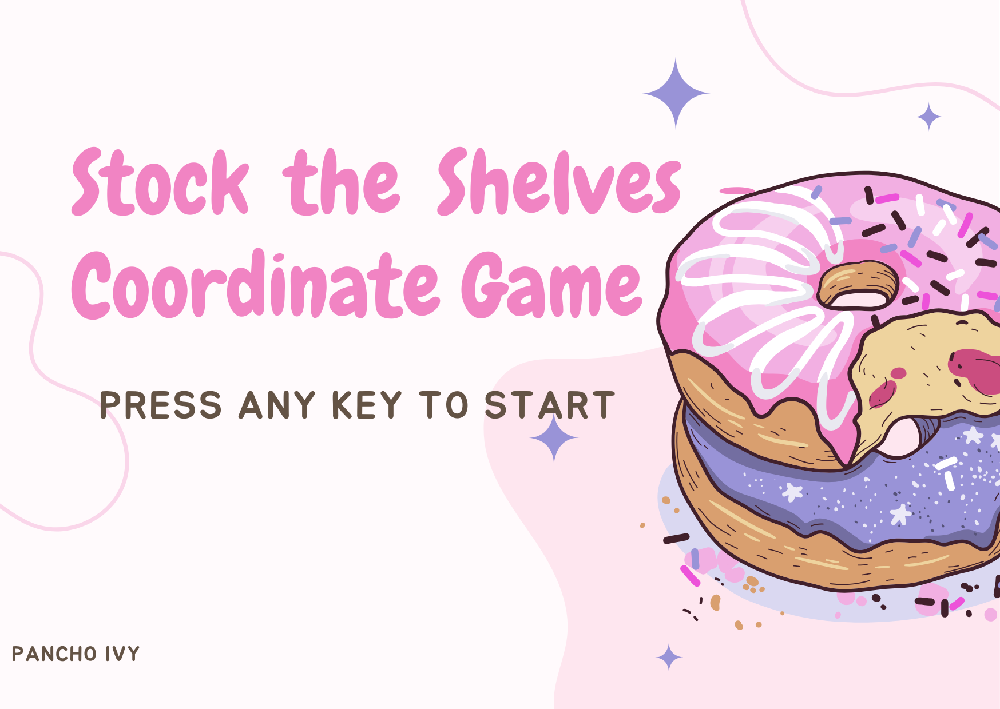

# Stock the Shelves - Coordinate Game

An interactive Cartesian coordinate educational puzzle game built with **Python** and **Pygame**.



## 🎮 About The Game
**Stock the Shelves** challenges players to practice coordinate geometry in a fun, fast-paced grocery shelving challenge! Players must locate and place various food items (pizza, sushi, steak, donuts, and more) at target (x, y) coordinates on a Cartesian plane before the 2-minute timer runs out.

## ✨ Features
- **Cartesian Coordinate Plane**: Real-time grid rendering with X and Y axes centered dynamically.
- **20+ Unique Food Items**: Pizza, tacos, sushi, donuts, coffee, and Philippine favorite adobo.
- **Sound & Music**: Interactive sound effects (`tap_sound.wav`) and background music.
- **Timer & Challenge**: 120-second countdown with custom victory (`win.png`) and fail (`fail.png`) screens.
- **Smooth 60 FPS gameplay** powered by Pygame.

## 🚀 How to Run

### Prerequisites
- Python 3.8+ installed
- Pygame library

### Installation
```bash
# Clone the repository
git clone https://github.com/ivyy-stack/stock-the-shelves.git
cd stock-the-shelves

# Install Pygame
pip install pygame
```

### Start the Game
```bash
python gamess.py
```

## ⌨️ Controls
- **Mouse Click**: Select coordinate points on the shelf plane
- **Keyboard (R)**: Restart game on game over screen
- **Any Key**: Start game from intro screen

## 👩‍💻 Author
**Ivy Pancho**  
- GitHub: [@ivyy-stack](https://github.com/ivyy-stack)
